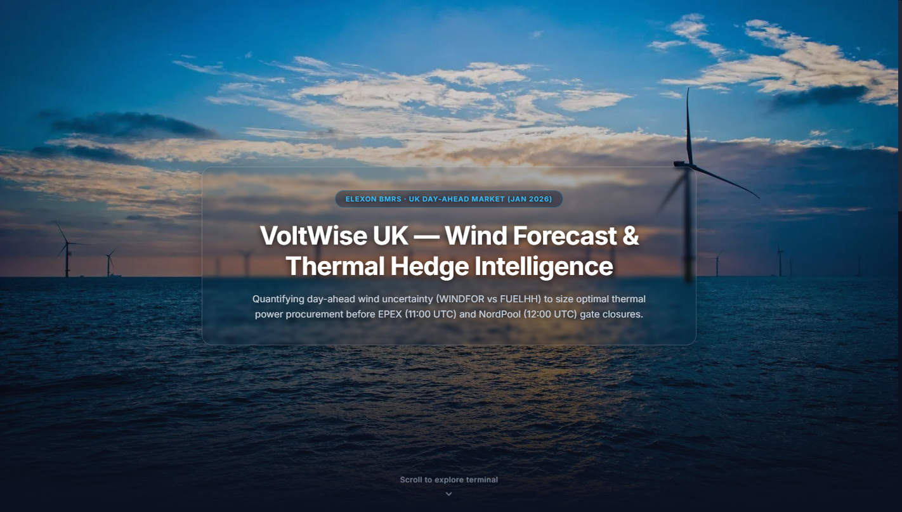
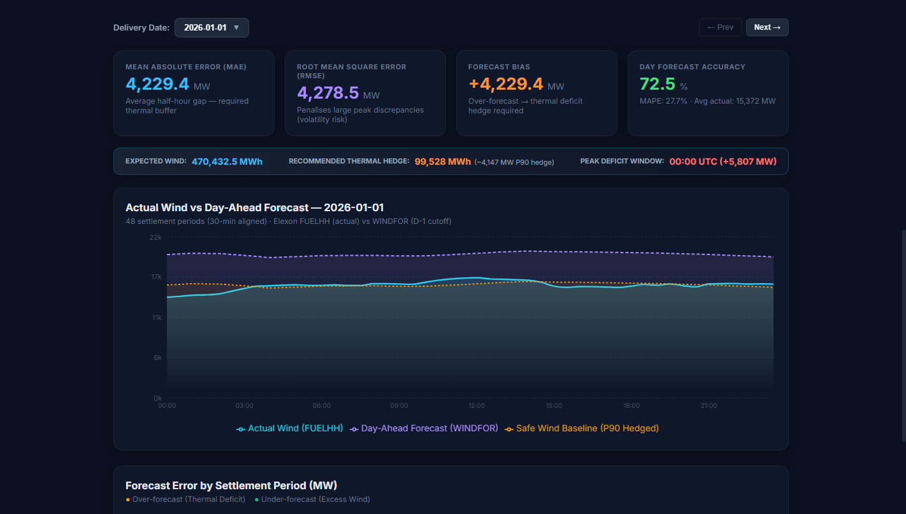
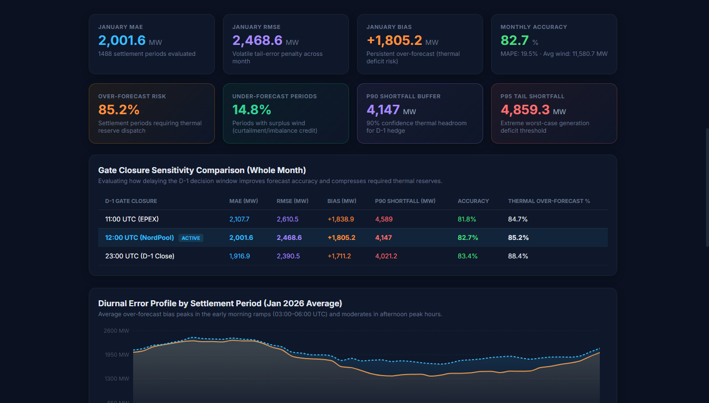
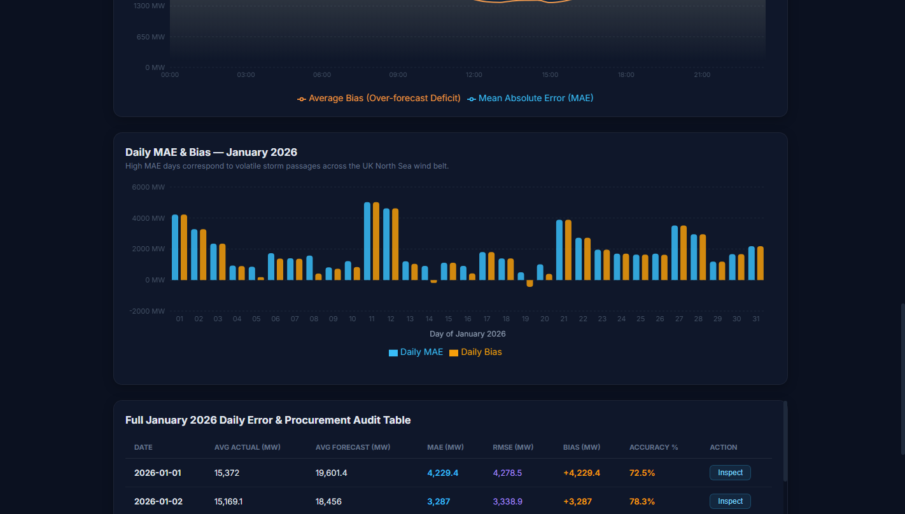

# VoltWise UK — Day-Ahead Wind Forecast & Procurement Evaluation

A production-grade web dashboard engineered for UK electricity procurement teams to evaluate day-ahead wind generation forecasts against outturn actuals across all 31 delivery days of **January 2026**.

The platform quantifies forecast risk, models required thermal backup hedges, evaluates gate closure sensitivity (EPEX vs NordPool vs D-1 close), and analyzes diurnal imbalance patterns across the 48 daily settlement periods.

---

## Visual Platform Preview

| Parallax Hero Landing | Daily Procurement View (Safe Wind Baseline) |
|:---:|:---:|
|  |  |

| Monthly Evaluation & Gate Closure Sensitivity | Diurnal Error Profile & Daily Audit Table |
|:---:|:---:|
|  |  |

---

## 1. Directory & File Structure

```
intern_demo/
├── backend/
│   ├── main.py              # FastAPI server: point-in-time D-1 matching, interpolation, precomputed cache & API
│   └── requirements.txt     # Python backend dependencies (FastAPI, Uvicorn, Pydantic, HTTPX)
├── frontend/
│   ├── index.html           # HTML shell with custom fonts & dark-mode tooltip styling
│   ├── vite.config.js       # Vite build configuration with development proxy (/api -> localhost:8000)
│   ├── package.json         # React 18 & Recharts charting dependencies
│   └── src/
│       ├── main.jsx         # React application mount
│       └── App.jsx          # Dashboard UI (Daily View, Decision Banner, Sensitivity, Diurnal Profile, Audit Table)
├── data_cache/
│   ├── fuelhh_jan2026.json  # Elexon actual wind generation across all settlement periods (Jan 2026)
│   └── windfor_jan2026.json # Elexon WINDFOR day-ahead wind forecasts with publication timestamps
├── Dockerfile               # Multi-stage production container (Node 20 build + Python 3.11 slim runtime)
├── docker-compose.yml       # Single-command container deployment
└── README.md                # Technical documentation, domain methodology & architecture
```

---

## 2. Domain Methodology & Quantitative Modeling

### 2.1 Decision Window Boundary & Look-Ahead Prevention
* **Decision Horizon**: Day-ahead power procurement decisions for January 2026 delivery days ($D \in [\text{2026-01-01}, \text{2026-01-31}]$) are executed on Day $D-1$.
* **Boundary Validation**: `WINDFOR` forecast records starting from `2025-12-30T02:30:00Z` ensure that delivery day `2026-01-01` has valid D-1 forecasts published before its gate closure on `2025-12-31`. All 31 delivery days contain 48 complete half-hour settlement periods (1,488 total periods).
* **Point-in-Time Gate Closure Filtering**: For target delivery day $D$, candidate forecasts are strictly restricted to:
  $$\text{publishTime} \le (D - 1)\text{ at } \text{gate\_closure\_utc}$$
  The record with $\max(\text{publishTime})$ is selected. This strictly prevents look-ahead bias from intraday or real-time revisions.

### 2.2 30-Minute vs 1-Hour Resolution Alignment
* Elexon `FUELHH` outturn actuals are recorded at 30-minute settlement periods (48 periods/day).
* Elexon `WINDFOR` day-ahead forecasts are published at hourly resolution (`:00` timestamps).
* Rather than using an artificial staircase step function, half-hour periods (`:30`) are aligned using **linear interpolation** between hour $H$ and $H+1$:
  $$\text{Forecast}(H:30) = \frac{\text{Forecast}(H:00) + \text{Forecast}(H+1:00)}{2}$$
  If $H+1$ is unavailable at gate closure, the value forward-fills from $H:00$.

### 2.3 Error Metrics & Statistical Risk Modeling
* **Forecast Error**: $\text{Error}_t = \text{Forecast}_t - \text{Actual}_t$
  * **Positive Error ($>0$)**: Over-forecast. Wind generation fell short of prediction, forcing the procurement desk to balance the deficit with thermal/peaking generation.
  * **Negative Error ($<0$)**: Under-forecast. Actual wind exceeded prediction (surplus / curtailment risk).
* **Mean Absolute Error (MAE)**: $\frac{1}{N}\sum |\text{Error}_t|$ (average volume buffer required).
* **Root Mean Square Error (RMSE)**: $\sqrt{\frac{1}{N}\sum (\text{Error}_t)^2}$ (heavily penalizes extreme volatility events).
* **Forecast Bias**: $\frac{1}{N}\sum \text{Error}_t$ (systematic tendency; January 2026 exhibited a persistent $+1,805\text{ MW}$ over-forecast bias).
* **P90 Shortfall Buffer**: 90th percentile of positive errors ($4,147\text{ MW}$ at 12:00 UTC).
* **Safe Wind Baseline (P90 Hedged)**:
  $$\text{Safe Baseline}_t = \max\left(0, \text{Forecast}_t - \text{P90\_Shortfall}\right)$$
  Provides traders with the wind capacity reliable at a 90% confidence level. The gap between Forecast and Safe Baseline defines the exact thermal hedge requirement.

---

## 3. How to Run Locally

### Option A: Local Development (Two Terminals)

#### Terminal 1 — Backend (FastAPI)
```powershell
# From project root
python -m venv venv
.\venv\Scripts\Activate.ps1   # On macOS/Linux: source venv/bin/activate
pip install -r backend/requirements.txt
python -m uvicorn backend.main:app --reload --port 8000
```
* Backend API: [http://localhost:8000](http://localhost:8000)
* Interactive Swagger Docs: [http://localhost:8000/docs](http://localhost:8000/docs)

#### Terminal 2 — Frontend (React + Vite)
```powershell
cd frontend
npm install
npm run dev
```
* Dashboard UI: [http://localhost:3000](http://localhost:3000)
*(Vite proxies all `/api` requests to `http://localhost:8000`)*

---

### Option B: Docker (Single Command)

```powershell
docker compose up --build
```
* Full app running at: [http://localhost:8000](http://localhost:8000)
* Stop with: `docker compose down`

---

## 4. Live Deployment Guide

> **Live Application URL**: `https://voltwise-uk-wind-dashboard.onrender.com` *(Configured on Render / Heroku / Vercel)*

### Method 1: Heroku (Docker Container Registry)
The repository includes a production multi-stage `Dockerfile` ready for Heroku's Container Runtime:

```bash
# 1. Login to Heroku and Heroku Container Registry
heroku login
heroku container:login

# 2. Create your Heroku application
heroku create voltwise-uk-wind-dashboard

# 3. Build and push the Docker container to Heroku
heroku container:push web --app voltwise-uk-wind-dashboard

# 4. Release the container
heroku container:release web --app voltwise-uk-wind-dashboard

# 5. Open the live app
heroku open --app voltwise-uk-wind-dashboard
```

### Method 2: Render.com (1-Click Docker Web Service — Free)
1. Navigate to **[dashboard.render.com](https://dashboard.render.com/)** and click **New +** → **Web Service**.
2. Select your connected GitHub repo: `knightrider-GH/w1n8t`.
3. Select **Docker** environment (Render detects the root `Dockerfile` automatically).
4. Click **Deploy Web Service**.

### Method 3: Vercel (Frontend) + Backend API
If deploying the frontend independently on Vercel:
1. Import `knightrider-GH/w1n8t` into Vercel and set the **Root Directory** to `frontend`.
2. Add the environment variable in Vercel settings:
   ```env
   VITE_API_URL=https://voltwise-uk-wind-dashboard.onrender.com
   ```
3. Deploy! Vercel serves the React UI and connects directly to the Python FastAPI backend.

---

## 5. AI Tool Disclosure

This application was developed with technical assistance from **Google Antigravity** (AI-powered agentic coding assistant). All Elexon BMRS data pipeline logic, point-in-time gate closure filtering, half-hour interpolation, statistical metric calculations, and React charting integrations were audited and verified for domain correctness and numerical accuracy.
